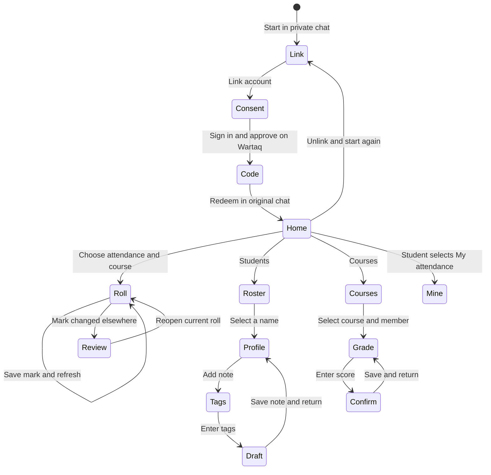

# Wartaq on Telegram

Open [@WartaqBot](https://t.me/WartaqBot) in a private chat and tap **Start**. Choose **Link account**, sign in to Wartaq and approve the connection. On the confirmation page, choose **Copy code**, then **Open Telegram**. Paste the eight digits into the same private chat and send them within five minutes. Returning to the bot or changing its language keeps the pending link. To discard it, use `/cancel`. Enter your Wartaq password on the Wartaq sign-in page.

Choose a task from the buttons under the message. Type a reply when a screen asks for a name, date, grade or note. The bot follows Telegram's language on first use. The language button switches between Arabic and English. Use the Telegram menu to reopen the notebook, cancel an action or disconnect.

| From the menu      | What you can do                                                                                                                                                                                                                    |
| ------------------ | ---------------------------------------------------------------------------------------------------------------------------------------------------------------------------------------------------------------------------------- |
| Students           | Search the roster, view or edit a profile, add a tagged note, review history and correct an entry. Administrators can add students.                                                                                                |
| Take attendance    | Choose a course and date, then tap Present, Absent or Excused. The refreshed roll shows the saved mark and progress. A conflicting mark requires review.                                                                           |
| Attendance summary | View course totals, six-session follow-up and anonymous attendance charts. Student accounts open their own attendance directly.                                                                                                    |
| Courses            | Browse courses and memberships. Administrators can create, rename, close or reopen courses, set thresholds, enroll students, assign course teachers, record grades and decisions, track handbooks and download five Excel reports. |
| Accounts           | Administrators can search accounts, review access and invite someone after confirming their number. The invitation button opens the private one-time message on Wartaq.                                                            |
| My account         | View or change your display name. The profile button opens the website for photos, phone and password changes. Account access changes and password resets also open Wartaq.                                                        |

The bot uses the same per-user [Wartaq MCP access](mcp.md) as other authorized clients. Offline attendance, chart-image exports and device settings are available in the browser. A message already delivered to Telegram may remain visible after unlinking or withdrawal of access.

## Editing a conversation

Each workflow returns a `Screen` with text, button rows and an optional next action for a typed reply. A button identifies the next route and its arguments. A workflow may return a new screen after a successful write. Telegram receives opaque button handles. The worker stores the route and arguments in its encrypted volume.

| To change                                           | Edit                                        | Verification                           |
| --------------------------------------------------- | ------------------------------------------- | -------------------------------------- |
| Home and available destinations                     | `telegram/menu.ts`, `telegram/routes.ts`    | Telegram integration and route tests   |
| Roster, attendance, notes or corrections            | `telegram/notebook/`                        | Telegram notebook tests                |
| Course details, memberships, grades or Excel files  | `telegram/courses/`                         | Telegram course tests                  |
| Profiles or invitations                             | `telegram/accounts/`                        | Telegram account tests                 |
| Button delivery, command handling or callback page  | `telegram/runtime/`                         | Telegram runtime tests                 |
| Browser linking, token refresh or permission checks | `telegram/auth.ts`, `telegram/transport.ts` | Telegram runtime and integration tests |

Add a destination to its workflow's route list and implement its screen. `Action.route` is derived from those lists, so misspelled button and prompt destinations fail type checking. Check the caller's available MCP tools before an action, and add a test that follows the real button or prompt through its side effect. Stored buttons from an older release can survive for fifteen minutes, so treat removed destinations as expired.

## Railway worker

`wartaq-telegram` runs one Bun process from `telegram/Dockerfile` in the AppSuite production project. Use the repository root as the build context, `main` as the source branch, Wait for CI, one replica and an always-on service. Attach a writable volume at `/data`. The public domain accepts the OAuth redirect at `/callback`. The worker receives Telegram updates through long polling. `/health` returns 200 after successful polling and 503 on a polling failure.

| Worker variable          | Value                                               |
| ------------------------ | --------------------------------------------------- |
| `TELEGRAM_BOT_TOKEN`     | BotFather token, supplied privately                 |
| `TELEGRAM_STORAGE_KEY`   | Base64-encoded 32 random bytes, supplied privately  |
| `TELEGRAM_DB_PATH`       | `/data/bot.sqlite`                                  |
| `WARTAQI_ORIGIN`         | `https://wartaqi.up.railway.app`                    |
| `TELEGRAM_PUBLIC_ORIGIN` | `https://wartaq-telegram-production.up.railway.app` |
| `PORT`                   | `3000`                                              |

Use canonical HTTPS origins without a trailing slash. The worker needs no application database URL or website signing secret. It registers an OAuth client, uses PKCE, and binds each login to the initiating chat and a browser-issued code. SQLite encrypts stored values with AES-256-GCM. Back up the volume and storage key privately as a pair. Losing either requires users to reconnect.

The worker claims each Telegram update before handling it. After an interruption or uncertain write, reopen the record to check its state. Buttons expire after fifteen minutes and are tied to their user, private chat and message. The bot edits the open message as you navigate. `/unlink` clears local access and requests provider revocation.

To restore the Telegram command menu and both public descriptions, run `bun scripts/configure-telegram.ts` with the bot token in the private environment. Use a separate bot identity for local long polling. Run `bun run verify:release` and build the worker with `docker build -f telegram/Dockerfile .`. A migrated disposable `TEST_RAILWAY_DATABASE_URL` enables the actual OAuth, role-switching and roster-write test.

To roll back a bot release, redeploy the previous successful worker image or take only the bot service offline. Keep its volume. Changes users already saved through Wartaq follow the website's normal correction and management workflows.
